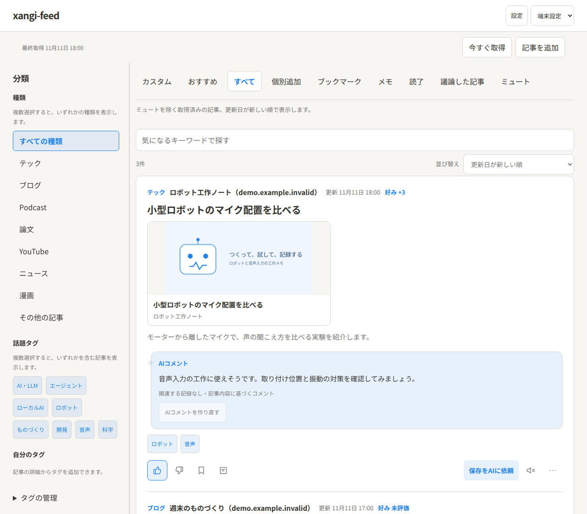

# xangi-feed

RSS・ブログ・論文・Podcast・YouTubeをまとめて読み、気になる記事を[xangi](https://github.com/karaage0703/xangi)と話せるフィードリーダーです。

  

画面例には、架空の記事・配信元・AIコメントを使っています。

## できること

- **読む** — 新着記事を画像付きカードで確認。種類・話題・配信元で絞り込めます。
- **好みを育てる** — Good／Badを付けて、関心に合う記事を見つけやすくします。
- **探す・話す** — 興味を入力してWebの記事を探したり、記事についてAIと議論したりできます。
- **残す** — ブックマーク・メモ・自分のタグで整理。AIと保存スキルを使ったNotion保存にも対応します。

## はじめに

1. **xangiを準備する** — 未導入なら[xangiのQuickstart](https://github.com/karaage0703/xangi#quickstart)から始めます。
2. **xangi-feedを登録して起動する** — [セットアップ手順](XANGI_SETUP.md)に沿って進め、xangiの拡張一覧から開きます。
3. **記事を読む** — 「設定」で配信元を確認し、「今すぐ取得」を押します。読みたいページは「記事を追加」から1件ずつ登録できます。
4. **好みを付ける** — 気に入った記事にGoodを付けます。「おすすめ」では、興味を入力して新しい記事を探せます。

日本語の要点・AIコメントを使う場合は、「設定 → 日本語の要点・AIコメント」で担当AIを選びます。リンクカードの表示や、リンクを開いたときの読了動作も設定から変更できます。

## ドキュメント

- [使い方](docs/usage.md) — 記事を読む・探す・整理する・AIと話す
- [セットアップ詳細](XANGI_SETUP.md) — 登録・起動・配信元の準備
- [ブックマークレット](docs/bookmarklet.md) — SafariやPCから記事を追加
- [設計・API・開発](docs/design.md)

## License

[MIT](LICENSE)
