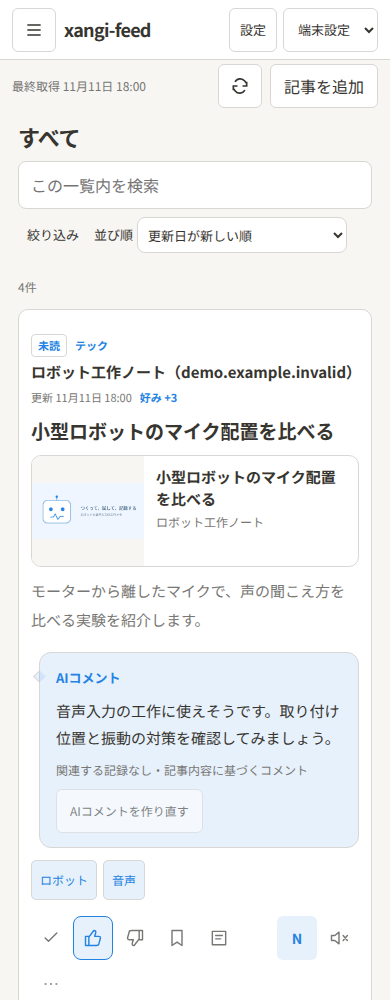

# 使い方

登録・起動は[セットアップ](../XANGI_SETUP.md)を参照してください。このガイドでは、起動後の画面操作を説明します。

## 記事を読む

「今すぐ取得」を押すと、登録した配信元の記事を取得します。記事のタイトルやリンクカードを押すと、原文が別タブで開きます。各記事には「未読／読了」（動画は「未視聴／視聴済み」）を表示します。操作列のチェックアイコンで読了を切り替えられます。操作名はツールチップと読み上げラベルで確認できます。「… → 記事の詳細」では要点・コメント・メモを確認できます。

## 左メニューの一覧とフィルター

左メニューで保存した一覧を選ぶと、その条件に合う記事を表示します。スマホでは上部のメニューボタンで一覧を選びます。各一覧の「…」は名前・複製・削除・並べ替えだけを行う「一覧設定」です。記事の条件は一覧上部の「絞り込み」から別画面で編集します。種類が先頭にあり、その下に読了・スキップなどの状態、好み・期間、タグ・配信元・保存キーワードが続きます。

初期一覧は特別な固定タブではなく、編集・名前変更・削除・並べ替えができる保存条件です。

- **カスタム** — 未読の記事からスキップを除きます。以前の標準カスタム設定を引き継ぎます。
- **すべて** — 未読・読了・スキップを含めます。
- **読了** — 読了だけ。読了にした順で表示します。
- **スキップ** — スキップした記事だけ。読了状態は問いません。
- **ブックマーク・メモ・議論した記事** — それぞれの記録がある記事。未読・読了の両方を含めます。
- **個別追加** — 個別に登録した記事。登録した順で表示します。
- **おすすめ** — おすすめ探索から見つけた未読記事。探索の設定は記事のフィルターとは別に保持します。

絞り込み画面では、種類・話題・自分のタグ・配信元・記事検索・並び順に加えて、読了状態、スキップの扱い、ブックマーク／メモ／議論の有無、追加経路、好みの下限・上限、期間、Badの除外などを設定できます。たとえば「読了」の初期一覧でも「未読と読了の両方」へ変えたり、「ポッドキャストだけ・好み10点以上・スキップを除く」という一覧を作れます。

好みの上限・下限は空欄なら制限しません。どちらかを指定すると未評価の記事は除外します。上限は下限以上にしてください。「分類を解除」は分類・検索・配信元の絞り込みを外し、読了状態など他のフィルターは保持します。

フィルターは変更すると選択中の一覧へ自動保存します。保存中・完了・失敗は一覧上部と絞り込み画面に表示します。失敗時は未保存の入力を残して一覧切替を止め、「保存を再試行」で再送できます。条件は自動保存され、名前だけ「名前を保存」で確定します。

## 一覧を追加・編集・並べ替える

左メニューの「＋ 一覧を追加」で名前を入力すると、選択中の一覧の条件を引き継いで末尾へ追加します。一覧名の横の「… → 名前・複製・並べ替え」で名前を変更し「名前を保存」を押します。「複製」は元の条件を引き継いだ別一覧を作ります。削除は確認後に一覧だけを削除し、記事・読了・スキップ・評価などは残します。初期一覧を削除しても再作成しません。

一覧の順序は名前の左のつまみをマウスでドラッグして変えられます。差し込む位置に線が表示されます。つまみを選んでAlt+↑/↓を押すか、設定内の「上へ移動」「下へ移動」も使えます。スマホやキーボードでも移動ボタンを使えます。初期一覧も並べ替えの対象です。

条件・名前・順序はサーバへ保存するため、別PCでも同じ一覧を使えます。以前作ったカスタム一覧も引き継ぎます。起動時は左メニューの先頭の一覧を開きます。他のPCでの編集は再読み込み、または一覧の選び直しで読み直します。同じ一覧の同時編集は最後の保存を採用します。並べ替え中に項目数が変わった場合は再読み込みを案内します。

自分で追加できる一覧は100件で、これに初期一覧9件が加わります。一覧が多い場合は左メニュー内を縦スクロールします。配信元候補の検索文字列・テーマ・パネル幅などの表示設定は端末ごとです。

## タグで絞り込まない・タグを増やす

話題タグと自分のタグは、それぞれ「絞り込まない」を選ぶと制限を解除できます。ほかの種類・配信元などの条件や、記事に付いているタグは変えません。選択中のタグをもう一度押して外すこともできます。

「話題タグ」はアプリ側で決めた語句から付ける自動分類で、候補は自動では増えません。「自分のタグ」は記事の「… → タグを編集」で自由な名前を入力して追加でき、作成したタグは絞り込み候補にも現れます。タグは1〜40文字、1記事20個までです。タグを選ばなければ、タグが付いていない記事も対象になります。

## 一時検索と保存するキーワード

読了条件は「絞り込み → 読了・スキップ・保存状態」の1か所で設定します。「未読だけ」「読了だけ」「未読と読了の両方」を選べます。条件の確認・変更はこの画面で行います。

記事一覧上部の「この一覧内を検索」は、今開いている一覧をさらに絞る一時検索です。保存済みの条件は変更しません。「検索を解除」、再読み込み、別一覧への切替で消えます。

毎回使いたいキーワードは「絞り込み → 話題タグ・自分のタグ・配信元・キーワード」の「保存するキーワード条件」へ入力します。一時検索を併用すると、保存したキーワードと一時検索の両方を満たす記事を表示します。

配信元は絞り込み画面のボタンから選択画面を開き、名前で検索して選びます。一度に表示する候補は先頭50件です。「すべての配信元」で制限を解除できます。選択しないまま検索欄に入力しても、保存済みの配信元は変わりません。

## 好みとカスタム条件

記事のGood／Badで、自分の関心を育てられます。ブックマーク・読了・メモとは独立しているので、読んだだけでは好みを変更しません。Badの理由には、興味の違いのほか、重複や要約の問題も指定できます。

絞り込みで「好み・期間」を開くと、好みの下限、表示期間、優先する要素、Badの非表示などを変更できます。すべての一覧で自動保存します。表示が少ない場合は下限を空欄、期間を0（全期間）に戻すか、「すべて」で確認してください。

「好み +2」のような点数は、Good／Badを付けた話題と記事から計算します。AIによる採点ではありません。設定から好みをリセットしても、記事・読了・メモ・ブックマークは残ります。

## おすすめの記事

「おすすめ」は、公開Webで見つけた未読記事のフィードです。配信元の登録やGoodがなくても、興味を入力して検索できます。

1. 「おすすめの設定」を開き、「検索のカスタムプロンプト」に探したい内容を入力します。例：**日本語のロボット工作記事を、直近7日から。広告は除く。**
2. 入力を止めると、条件を自動保存して検索します。
3. 同じ条件でもう一度探すときは「今すぐ探す」を押します。

おすすめの設定は初期状態で閉じています。設定後は見出しを押して折りたためます。閉じても入力内容と自動保存は保持します。

一覧には検索中や失敗時の状態を短く表示します。検索条件・更新時刻・次回の探索予定・記録の利用状況は「おすすめの設定」を開くと確認できます。失敗した場合は入力が残るので、再試行してください。「自分の記録を使う」は初期ONです。xangi-searchに登録済みの会話・ノートなどから、具体的な作業や関心に合う検索テーマを作ります。担当AIの設定が必要です。Notion全体や未登録の会話を直接読む機能ではありません。

テーマに一致した記事には「自分とのつながり」と「検索テーマに使った記録」を表示します。記録のパスと抜粋を開いて確認できます。記録は関連性で検索するため、必ず最新とは限りません。新しさは記録に書かれた日付から判断します。記録の抜粋は担当AIへ、作った検索語は公開検索へ送ります。

記録が取れない、関連テーマが作れない、担当AIが応答しない場合は、入力条件とGoodから得た話題で探し、状態を表示します。記録の利用をOFFにすると新しい探索での参照を止めて検索し直します。過去に取り込んだ記事やその推薦根拠は残ります。「定期的に探す」で自動検索のON／OFFと間隔を変更できます。

見つかった記事は自動で記事一覧へ入り、「すべて」にも表示します。通常の記事と同じカードで、Good／Bad、ブックマーク、メモ、タグ、ミュート、共有、AIコメント、議論、保存依頼を使えます。読了にするとおすすめから外れ、「すべて」「読了」に残ります。「未読に戻す」でおすすめに戻せます。

検索条件を変えても過去に見つかった記事は履歴として残ります。同じURLが再び見つかっても、評価・メモ・読了状態は保持します。配信元は自動登録せず、以後の配信元全体の取得は通常の登録から行います。

見つけられるのは、公開フィードで記事と日付を確認できるページです。検索語・言語・期間・除外語の条件によっては0件になることがあります。

## 画像付きリンクカード

記事一覧と詳細に、リンク先の画像・タイトル・サイト名を表示します。初期設定はON。「設定 → リンクカード」でOFFにし、「リンクカードの設定を保存」を押すと非表示になります。この設定はサーバへ保存します。

取得済みのカードはキャッシュから表示します。初回や通信が遅い場合は画像が後から表示されます。カードの高さは読み込み前から確保し、画像がないページも文字だけで同じ高さに収めます。カードを見るだけでは読了になりません。

## スクロールでスキップ

「設定 → スクロールでスキップ」でONにできます（初期値OFF、このブラウザに保存）。カスタム・おすすめ・すべて・個別追加で、一度画面に表示された未読記事が、下へのスクロールで画面上端から完全に外れると自動ミュートします。まだ表示されていない記事、ブックマーク、読了記事は対象外です。設定や記事詳細などのダイアログを開いている間も処理しません。

読了やGood／Bad、メモは変えません。カードは位置を保つため次の一覧更新まで残し、再読込後は通常の一覧から外れます。「ミュート」から確認・解除できます。保存に失敗した場合は画面にエラーを表示し、記事を再表示して通過すると再試行できます。

## スクロールでスキップ

「設定 → スクロールでスキップ」でONにできます（初期値OFF、このブラウザに保存）。カスタム・おすすめ・すべて・個別追加で、一度画面に表示された未読記事が、下へのスクロールで画面上端から完全に外れると自動ミュートします。まだ表示されていない記事、ブックマーク、読了記事は対象外です。設定や記事詳細などのダイアログを開いている間も処理しません。

読了やGood／Bad、メモは変えません。カードは位置を保つため次の一覧更新まで残し、再読込後は通常の一覧から外れます。「ミュート」から確認・解除できます。保存に失敗した場合は画面にエラーを表示し、記事を再表示して通過すると再試行できます。

## 読了とミュート

初期設定では、記事・動画・音声のリンクを開くと読了になります。「設定 → 読了の動作」でOFFにすると、明示的に読了へ追加するまで未読のままです。

「… → 読んだ／視聴済み」で手動追加し、「未読に戻す」で戻せます。記事の詳細・コピー・共有・Notion保存だけでは読了になりません。

「… → ミュート」で記事を一覧から隠せます。「ミュート」一覧から解除できます。ミュートはGood／Badの評価を変更しません。

一覧の既読・ブックマーク・スキップは保存した記事だけを判定し、通常は一覧全体を読み直しません。条件から外れた記事だけが一覧から外れ、読み込んだ件数や他の記事の順序を保ちます。

## ブックマーク・メモ・タグ

- **ブックマーク** — しおりのアイコンで付け外しします。押した状態はすぐ表示し、保存中は二重操作を防ぎます。保存失敗時は操作前へ戻してお知らせします。
- **メモ** — 「メモを書く」から記事詳細へ移り、4000文字まで入力して保存します。空欄で保存すると消せます。メモは自動解説や好みの学習に使いません。
- **自分のタグ** — 記事詳細から付け外しし、分類パネルから絞り込めます。タグの削除は全記事から外しますが、記事そのものは残ります。

編集中のメモは画面内で下書きを保持します。画面を離れる前に「メモを保存」を押してください。

## 記事を1件だけ追加

「記事を追加」で公開ページのURLを入力します。タイトルと抜粋を自分で補足することもできます。追加した記事は「個別追加」で確認できます。

記事詳細の「本文を取得／再取得」で本文を補えます。ログインやJavaScriptの実行が必要なページは取得できないことがあります。再取得してもメモ・評価・読了は保持します。

SafariやPCのブラウザから送る場合は、[ブックマークレット](bookmarklet.md)も使えます。

## 配信元を追加・停止する

「設定 → 配信元を追加」で名前・URL・種類を指定します。RSS／Atomのほか、YouTubeのチャンネルURL・ID・@ハンドルにも対応します。登録例は[catalog.sample.json](../catalog.sample.json)を参照してください。

設定の配信元一覧で、取得状況の確認・停止・再開・削除ができます。停止や削除をしても取得済みの記事は残ります。同じURLを追加すると再開できます。

YouTubeは公開情報と、取得できる場合の公開字幕を読むための機能です。動画・音源ファイルのダウンロードは行いません。字幕取得の準備は[セットアップ](../XANGI_SETUP.md)と[開発資料](design.md#直接追加の本文取得)を参照してください。

## 日本語解説とAIコメント

「設定 → 日本語の要点・AIコメント」で、担当AI・自動解説・待ち時間を設定します。AIは記事の抜粋や取得済み本文から、日本語の見出し・要点・推薦コメントを生成します。

xangi-searchが利用できる場合は、関連する記録もコメントの参考にします。吹き出しの「コメント生成時に参照した記録」から、使った記録のファイル名・パスと抜粋を確認できます。コメントは記事を何に使えそうか、どのように試せるかを説明します。ファイル名や参照番号は本文に並べず、参照欄で確認できます。書き直しが必要なコメントは要約を残して再生成します。関連記録がない場合は、記事内容に基づくコメントとして表示します。

生成済みの見出し・要点・コメントは表示中の記事へ自動で反映します。反映ボタンを押す必要はなく、読み込んだ件数・記事順や入力中のメモは保持します。「新着○件を表示」は新しい記事を一覧へ読み込む別の操作です。

「AIコメントを作る／作り直す」で再生成できます。更新中や失敗時も、前回の解説は保持します。失敗から15分経過した記事は、再表示や拡張起動時にも再試行します。

AI処理を止めるときは「自動解説」を停止します。自動解説の件数を0にするだけでは、一覧に表示した記事の生成は停止しません。記事本文・関連記録の抜粋は担当AIへ送られ、利用するモデルの料金が発生する場合があります。

## 記事についてAIと話す

「… → xangiと話す」で質問と担当を選びます。記事の文脈を渡した会話が別タブで開きます。既存の会話がある場合は続きから開け、別の担当に相談するときは「新しい会話」を選べます。

ポップアップを許可してください。送信できたか不明な場合は、再送する前に会話一覧を確認します。

## AIにNotion保存を依頼する

1. xangiでNotionを使えるようにし、保存先・内容を保存スキルに記載します。同梱の[保存スキル](../skills/xangi-feed-save/SKILL.md)を元に、workspace側へ自分用のスキルを用意できます。
2. 「設定 → AIとスキルによるNotion保存」で担当AIとスキル名を指定します。
3. 記事の「保存をAIに依頼」を押し、「保存用の会話を開く」で進行状況を確認します。

「保存AIへ依頼済み」は受付を示します。AIから結果が報告されると、完了・一部保存・回答待ち・未完了とページへのリンクを表示します。依頼中は同じ記事を重複して送りません。

詳しい保存対象・スキルの配置・カスタマイズは[保存スキルの説明](../skills/xangi-feed-save/SKILL.md)を参照してください。アプリへNotionキーを入力する必要はありません。

## スマホ・表示設定

画面例には、架空の記事・配信元・AIコメントを使っています。

表示テーマはヘッダーの「端末設定／ライト／ダーク」から選びます。スマホでは横に並ぶ一覧名をスクロールできます。

iPhoneのホーム画面版でSafariアプリを使いたい場合は、「設定」で「Safariアプリで開く」をONにします。この選択は端末ごとに保存されます。

## 困ったとき

- **記事が出ない** — 「すべて」に切り替え、絞り込みを解除し、「今すぐ取得」を押します。配信元の有効／停止と取得エラーを設定で確認してください。
- **画像が出ない** — リンクカードの設定を確認します。画像がない・取得できないサイトは文字だけで表示します。
- **AI解説が出ない** — 担当AI・自動解説の有効状態・待ち時間を確認します。記事詳細から作り直せます。
- **保存が終わらない** — 保存用の会話で、AIの回答や不足情報を確認します。

接続やデータ保存先の確認は[セットアップ](../XANGI_SETUP.md)、APIや検証手順は[設計・開発資料](design.md)を参照してください。

## AIの実行経路と互換性

AI生成は本体経由が標準です。担当未設定なら本体の既定backend・modelで実行し、設定画面に担当と接続先を表示します。旧版が保存した担当は自動で消しません。空にして保存すると本体の既定へ戻ります。親の接続先はXANGI_EXTENSION_HOST_URLから受け取り、XANGI_URLは利用者が別instanceを明示指定する場合だけ設定します。

ローカルモデルへ直接接続する必要がある場合だけ、親の環境でXANGI_FEED_DIRECT_LLM=1を明示し、登録local-llm担当を選びます。LOCAL_LLM_BASE_URL/API_KEY/MODELを使います。設定画面に直接接続を許可したモードを表示します。この経路は本体の停止・監視・会話履歴・利用量記録の対象外です。フラグ未設定ではLOCAL_LLM環境変数があっても本体経由です。

本体にはmanaged HTTP schema 2、sessions/chat、agents、runtime-settingsのAPIが必要です。本体の実版との通し確認は未実施です。拡張単体のmock・回帰テストと区別し、実機確認した際に本体版と未確認範囲を記録します。
