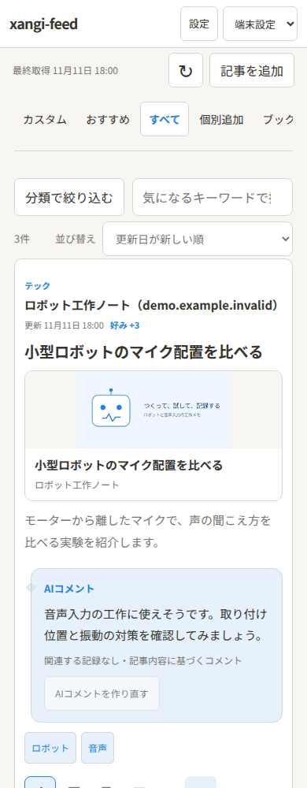

# 使い方

登録・起動は[セットアップ](../XANGI_SETUP.md)を参照してください。このガイドでは、起動後の画面操作を説明します。

## 記事を読む

「今すぐ取得」を押すと、登録した配信元の記事を取得します。記事のタイトルやリンクカードを押すと、原文が別タブで開きます。「… → 記事の詳細」では要点・コメント・メモを確認できます。

- **すべて** — 取得済みの記事を読む一覧です。
- **カスタム** — 未読の記事を、好み・期間などの条件で絞り込む一覧です。
- **個別追加** — 「記事を追加」やブックマークレットで登録したページを確認します。
- **ブックマーク・メモ・読了・議論した記事** — あとで読みたい記事や、自分の記録から振り返ります。

種類・話題・配信元・自分のタグは左の分類パネルで選びます。スマホでは「分類で絞り込む」を開きます。検索欄では、空白で区切った言葉をすべて含む記事を探せます。選択した条件は一覧ごとに保存され、「すべて解除」で戻せます。

並び替えは件数の横から選びます。「読了」は読了にした順、「個別追加」は登録した順が初期設定です。

## 好みとカスタム条件

記事のGood／Badで、自分の関心を育てられます。ブックマーク・読了・メモとは独立しているので、読んだだけでは好みを変更しません。Badの理由には、興味の違いのほか、重複や要約の問題も指定できます。

「カスタム条件」を開くと、好みの下限、表示期間、優先する要素、Badの非表示などを変更できます。変更は自動保存されます。表示が少ない場合は下限を空欄、期間を0（全期間）に戻すか、「すべて」で確認してください。

「好み +2」のような点数は、Good／Badを付けた話題と記事から計算します。AIによる採点ではありません。設定から好みをリセットしても、記事・読了・メモ・ブックマークは残ります。

## おすすめの記事

「おすすめ」は、公開Webから新しい記事を探す画面です。配信元の登録やGoodがなくても、興味を入力して検索できます。

1. 「検索のカスタムプロンプト」に探したい内容を入力します。例：**日本語のロボット工作記事を、直近7日から。広告は除く。**
2. 入力を止めると、条件を自動保存して検索します。
3. 同じ条件でもう一度探すときは「今すぐ探す」を押します。

検索結果の上に、適用した条件と状態を表示します。失敗した場合は入力が残るので、再試行してください。興味を空欄にすると、Goodから得た話題を使います。「定期的に探す」で自動検索のON／OFFと間隔を変更できます。

見つけられるのは、公開フィードで記事と日付を確認できるページです。検索語・言語・期間・除外語の条件によっては0件になることがあります。

## 画像付きリンクカード

記事一覧と詳細に、リンク先の画像・タイトル・サイト名を表示します。初期設定はON。「設定 → リンクカード」でOFFにし、保存できます。

取得済みのカードはキャッシュから表示します。初回や通信が遅い場合は画像が後から表示され、画像がないページは文字だけのカードになります。カードを見るだけでは読了になりません。

## 読了とミュート

初期設定では、記事・動画・音声のリンクを開くと読了になります。「設定 → 読了の動作」でOFFにすると、明示的に読了へ追加するまで未読のままです。

「… → 読んだ／視聴済み」で手動追加し、「未読に戻す」で戻せます。記事の詳細・コピー・共有・Notion保存だけでは読了になりません。

「… → ミュート」で記事を一覧から隠せます。「ミュート」一覧から解除できます。ミュートはGood／Badの評価を変更しません。

## ブックマーク・メモ・タグ

- **ブックマーク** — しおりのアイコンで付け外しします。
- **メモ** — 「メモを書く」から記事詳細へ移り、4000文字まで入力して保存します。空欄で保存すると消せます。メモは自動解説や好みの学習に使いません。
- **自分のタグ** — 記事詳細から付け外しし、分類パネルから絞り込めます。タグの削除は全記事から外しますが、記事そのものは残ります。

編集中のメモは画面内で下書きを保持します。画面を離れる前に「メモを保存」を押してください。

## 記事を1件だけ追加

「記事を追加」で公開ページのURLを入力します。タイトルと抜粋を自分で補足することもできます。追加した記事は「個別追加」で確認できます。

記事詳細の「本文を取得／再取得」で本文を補えます。ログインやJavaScriptの実行が必要なページは取得できないことがあります。再取得してもメモ・評価・読了は保持します。

SafariやPCのブラウザから送る場合は、[ブックマークレット](bookmarklet.md)も使えます。

## 配信元を追加・停止する

「設定 → 配信元を追加」で名前・URL・種類を指定します。RSS／Atomのほか、YouTubeのチャンネルURL・ID・@ハンドルにも対応します。登録例は[catalog.sample.json](../catalog.sample.json)を参照してください。

設定の配信元一覧で、取得状況の確認・停止・再開・削除ができます。停止や削除をしても取得済みの記事は残ります。同じURLを追加すると再開できます。

YouTubeは公開情報と、取得できる場合の公開字幕を読むための機能です。動画・音源ファイルのダウンロードは行いません。字幕取得の準備は[セットアップ](../XANGI_SETUP.md)と[開発資料](design.md#直接追加の本文取得)を参照してください。

## 日本語解説とAIコメント

「設定 → 日本語の要点・AIコメント」で、担当AI・自動解説・待ち時間を設定します。AIは記事の抜粋や取得済み本文から、日本語の見出し・要点・推薦コメントを生成します。

xangi-searchが利用できる場合は、関連する記録もコメントの参考にします。吹き出しの「コメント生成時に参照した記録」から、使った資料と抜粋を確認できます。関連記録がない場合は、記事内容に基づくコメントとして表示します。

「AIコメントを作る／作り直す」で再生成できます。更新中や失敗時も、前回の解説は保持します。失敗から15分経過した記事は、再表示や拡張起動時にも再試行します。

AI処理を止めるときは「自動解説」を停止します。自動解説の件数を0にするだけでは、一覧に表示した記事の生成は停止しません。記事本文・関連記録の抜粋は担当AIへ送られ、利用するモデルの料金が発生する場合があります。

## 記事についてAIと話す

「… → xangiと話す」で質問と担当を選びます。記事の文脈を渡した会話が別タブで開きます。既存の会話がある場合は続きから開け、別の担当に相談するときは「新しい会話」を選べます。

ポップアップを許可してください。送信できたか不明な場合は、再送する前に会話一覧を確認します。

## AIにNotion保存を依頼する

1. xangiでNotionを使えるようにし、保存先・内容を保存スキルに記載します。同梱の[保存スキル](../skills/xangi-feed-save/SKILL.md)を元に、workspace側へ自分用のスキルを用意できます。
2. 「設定 → AIとスキルによるNotion保存」で担当AIとスキル名を指定します。
3. 記事の「保存をAIに依頼」を押し、「保存用の会話を開く」で進行状況を確認します。

「保存AIへ依頼済み」は受付を示します。AIから結果が報告されると、完了・一部保存・回答待ち・未完了とページへのリンクを表示します。依頼中は同じ記事を重複して送りません。

詳しい保存対象・スキルの配置・カスタマイズは[保存スキルの説明](../skills/xangi-feed-save/SKILL.md)を参照してください。アプリへNotionキーを入力する必要はありません。

## スマホ・表示設定

画面例には、架空の記事・配信元・AIコメントを使っています。

表示テーマはヘッダーの「端末設定／ライト／ダーク」から選びます。スマホでは横に並ぶ一覧名をスクロールできます。

iPhoneのホーム画面版でSafariアプリを使いたい場合は、「設定」で「Safariアプリで開く」をONにします。この選択は端末ごとに保存されます。

## 困ったとき

- **記事が出ない** — 「すべて」に切り替え、絞り込みを解除し、「今すぐ取得」を押します。配信元の有効／停止と取得エラーを設定で確認してください。
- **画像が出ない** — リンクカードの設定を確認します。画像がない・取得できないサイトは文字だけで表示します。
- **AI解説が出ない** — 担当AI・自動解説の有効状態・待ち時間を確認します。記事詳細から作り直せます。
- **保存が終わらない** — 保存用の会話で、AIの回答や不足情報を確認します。

接続やデータ保存先の確認は[セットアップ](../XANGI_SETUP.md)、APIや検証手順は[設計・開発資料](design.md)を参照してください。
